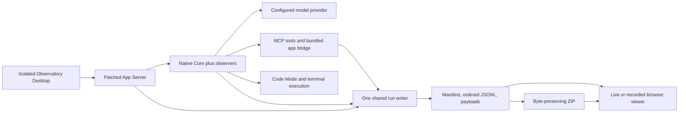

# Codex Harness Observatory guide

## Version and source authority

`codex_harness_observatory/release.json` owns the Observatory version, exact upstream Core tag and commit, signed Desktop package digest, companion patch inputs, native artifact names, and archive digests. The runtime reads it; source launchers and release checks use the same descriptor.

The 0.3 target is Desktop 26.1029.61003 with Core 0.166.0-alpha.6. Stable terminal Core 0.166.0 is a separate build. Release artifacts are prepared locally until explicitly published.

## Architecture



These are logical responsibilities, not necessarily separate processes. Code Mode is an execution helper, not a second model server. Local vLLM instances are not required.

One dedicated App Server lifetime is one shared trace. Its writer starts before the first connection or root. Session traffic remains unattributed; independent human chats, ephemeral Desktop jobs, and children retain their own identities. A root ending does not close a run containing other work.

## Live capture

Live capture supports Linux x86_64. The prepared GNU Core binaries require glibc 2.39 or newer; their dynamic-library requirements are recorded in the native package report. Install the package's capture extra, or use the source checkout and its dependencies. Select an existing mode-0700, short real directory with `OBSERVATORY_CODEX_HOME`; a normal-profile fallback and symlinked homes are rejected. The launcher checks socket length before starting.

```bash
mkdir -m 700 "$HOME/.codex-observatory-lecture"
export OBSERVATORY_CODEX_HOME="$HOME/.codex-observatory-lecture"
codex-harness-observatory --gui
# Source route:
./run.sh --desktop
```

The installed route verifies descriptor-pinned archives before extraction and before reuse. `OBSERVATORY_ARTIFACT_CACHE` selects a cache directory for already-built local artifacts. Archives must have the descriptor's exact names and hashes; an unpublished release is not permission to use an arbitrary executable.

The Desktop runs with a separate application identity, Core home, Electron user data, HOME, XDG config/data/state/cache/runtime, temporary storage, D-Bus session, app-tools pipe, and service sockets. `CODEX_ELECTRON_USER_DATA_PATH` is set before startup so login-shell environment loading retains the dedicated Core home. The candidate's temporary-service paths are patched consistently. Core keeps its native protected physical socket directory, `/tmp/codex-daemon-$UID`, because its sandbox expects that location. A unique profile-derived hashed endpoint is advertised through the private profile rendezvous. Startup verifies both locations and ownership; cleanup removes only this launch's endpoint and never the shared parent directory. Static system MIME and icon resources may be read for native dialogs; writable XDG state remains private.

Authenticate this dedicated profile separately. Keep model and reasoning effort in its configuration. Effective values are part of run evidence. Launch and cleanup are scoped to this dedicated candidate.

At shutdown, the launcher snapshots its own live descendant tree and pins verified process identities with Linux PID file descriptors. This includes terminal jobs that create another session or process group. It stops surviving owned descendants before checking the socket's recorded identity and use. An incomplete ownership check is reported; paths with changed identity or a socket still in use are retained.

The in-app browser remains available. The Chrome native extension bridge is disabled in this candidate because its compiled path cannot be isolated through supported configuration. The archive provenance identifies that limitation. This does not change installed Chrome.

## Recorded viewing and sharing

```bash
codex-harness-observatory --view /path/to/bundle
codex-harness-observatory --view /path/to/bundle/trace.jsonl
codex-harness-observatory --view /path/to/bundle.zip
codex-harness-observatory --export /path/to/bundle /path/to/bundle.zip
```

Recipients need Python 3.11+, the installed wheel, and a modern browser. Replay does not import Linux terminal support, load Desktop, initialize codex-configure, start Core, or use authentication. ZIP extraction is private and is removed after the viewer stops.

An export copies only the selected bundle, including unfamiliar regular files and optional `state.json`. It does not copy the enclosing run directory, profile, or service logs. File bytes, unknown supported-version events, and legacy identities are preserved. Export does not generate reduced state or invent a closing event.

Unsafe paths, ambiguous bundle layouts, path collisions, unsupported file types, missing referenced artifacts, and a source changing during export are errors. Stable interrupted captures can be exported and remain partial. Existing output files are not replaced.

The operator chooses and reviews authentic recordings for sharing. Full content remains full content. Hashes detect changes but do not establish authorship, completeness, or absence of sensitive content. Display redaction is a presentation mode, not a sanitization process.

## Evidence and schema contract

A bundle contains `manifest.json`, append-only `trace.jsonl`, `payloads/`, and optional reduced state. The 0.3 writer uses manifest 4, raw 6, and reduced 5. The current reducer requires the current contract. Older supported captures remain directly viewable without modification or automatic reduction.

Large event metadata can use an `oversized_event` wrapper referencing the original typed payload. The reducer and viewer expand it while retaining the original wrapper and artifact. Full requests, responses, code, tool results, and metadata are not silently shortened to fit a row.

The raw sequence is serialized append order. It is not a universal causal clock or physical network order. Durations require matched boundaries; explicit IDs establish relationships. Direct observations, correlated associations, and reconstructed context are labeled separately. Missing or ambiguous identity stays unknown.

App Server request IDs retain numeric versus string type. Connection instances, directions, and exchange IDs disambiguate reuse, concurrent requests, errors, cancellation, and reconnect. Stdio/WebSocket messages are captured as parsed JSON; remote/in-process and MCP observations occur at typed semantic boundaries, after which unknown discarded members cannot be recovered. A local transport handoff does not prove peer receipt.

Model evidence distinguishes prepared startup WebSocket warmup bodies, prepared generation and incremental requests, logical snapshots after warmup, completed or partial outputs, history admission, and context later sent to the model. A startup warmup is attributed to its thread and session; it does not create a user turn or establish delivery. Provider-exposed reasoning-associated text and opaque provider data may be retained; the collector has no access to inaccessible hosted private reasoning or provider-side cache state. Authentication headers and routing-cookie values are outside these request-body observations.

Compaction evidence separates request input, candidate, pre-install live history, adopted replacement, rejection, and cancellation. Mail acceptance, input draining, model admission, and consumption are distinct. Approval cache use, reviewer preparation, assessment, decision, escalation, and retry are distinct. Hook proposals and confirmed effects are distinct.

## Health, coverage, and limitations

Writer health records attempted/written events and payloads and serialization, append, payload-write, and finalization failures. It is best effort. If storage cannot persist a failure record, final health is unknown. A syntactically clean or contiguous JSONL stream is not a completeness certificate.

The viewer reports missing artifacts, partial records, interrupted runs, unsupported schemas, and reported losses. Its original-text/byte view is separate from formatted JSON, whose presentation can change whitespace or number representation.

`tools/collection_inventory.json` is a versioned inventory generated from the exact stock binary's experimental schemas and source declarations. It distinguishes:
- Public API and internal/schema-excluded availability.
- Native trace events and Observatory extensions.
- Stated collection boundaries and their limitations.
- Traffic actually observed in a selected capture.
- Acceptance scenarios actually exercised.

The inventory compares stable and experimental schemas to identify opt-in methods and fields. Regenerate it with `python -m tools.collection_inventory --schema-dir EXPERIMENTAL_SCHEMAS --stable-schema-dir STABLE_SCHEMAS --upstream-source UPSTREAM_SOURCE --instrumented-source . --release codex_harness_observatory/release.json --output tools/collection_inventory.json`. Add `--capture BUNDLE` and a separate output path to report observed traffic without changing the declarations.

`python -m tools.validate_collection --native STOCK_CORE --candidate CANDIDATE_CORE --descriptor codex_harness_observatory/release.json --output NEW_PRIVATE_DIRECTORY` runs the offline model/tool equivalence and protocol collection probe. Its report lists every normalized generated identity and its bounded scenario; it does not establish universal behavioral equivalence.

Actual capability negotiation, notification filters, raw-event opt-in, subscriptions, and inherited child settings are recorded. A separate validation client exercises optional surfaces; the Desktop's normal choices are not rewritten to manufacture coverage. Unseen methods are unexercised, not automatically unsupported.

Standalone restoration before a writer exists remains outside collection. Shared App Server startup avoids that pre-root gap. Typed transports do not reconstruct original network bytes. Provider caches, encrypted transport, and unreported external actions are outside collection.

## Build and release preparation

The Desktop builder clones the pinned companion revision into managed temporary storage, applies the versioned socket and isolation patches, uses pinned ASAR tooling, checks the applied report, and produces a separate relocatable archive.

```bash
./build-desktop-observatory.sh \
  --upstream-deb /path/to/verified-chatgpt.deb \
  --archive /path/to/codex-harness-observatory-desktop-0.3.0-linux-x86_64.tar.gz
```

Build the matching native executables using the pinned Rust toolchain. The target's `.github/actions/setup-rusty-v8` download step verifies the published archive, but its published binding disagrees with that archive's Unix sandbox ABI. Keep those upstream assets unchanged and generate the matching binding with the Observatory helper. `core.v8` in the release descriptor owns the archive, generator, source, and generated binding pins.

```bash
python -m tools.build_observatory_v8_binding \
  --bazel /path/to/pinned/bazel \
  --archive /path/to/verified/librusty_v8.a.gz \
  --work-dir /path/to/new-v8-workspace \
  --cache-dir /path/to/private-v8-cache \
  --output /path/to/new-generated-binding.rs
export RUSTY_V8_ARCHIVE=/path/to/verified/librusty_v8.a.gz
export RUSTY_V8_SRC_BINDING_PATH=/path/to/new-generated-binding.rs
```

The helper exports the exact upstream commit into a separate workspace, selects its existing sandbox-release binding producer, excludes machine/home Bazel settings, and rejects an archive or generated binding with the wrong digest. Its provenance states the verification boundary. Local runtime canaries and archive inspection separately checked typed-array limits, CppGC layout and collection, and sandbox identity; they do not prove every possible ABI behavior.

Build `bwrap` first and export its finalized SHA-256 as `CODEX_BWRAP_SHA256` before compiling Core. The package requires `codex`, `codex-code-mode-host`, `codex-exec-server`, `bwrap`, and `rg`.

After the required checks and formatting, pin the canonical Rust patch digest in `core.observatory_patch_sha256`, then assemble the matching package with the checked wrapper:

```bash
python -m tools.build_observatory_core \
  --bin-dir /path/to/final/binaries \
  --output-dir /path/to/existing/output-directory \
  --profile dev --optimization unoptimized
```

The wrapper verifies the complete staged or committed Rust patch against the pinned upstream commit, rejects omitted untracked Rust source, and delegates to the canonical package builder. The supplied binary profile and its source linkage remain explicit caller assertions in its report.

The current build and native acceptance environment is the dedicated Ubuntu vm02 guest. Source, caches, targets, artifacts, and synthetic test evidence live on its separate `/srv/observatory-0166` build disk. Host browser and Desktop connections are not part of this test route. Use a fresh guest-only profile; the guest CUA display is controlled over SSH without X11 forwarding.

The VM acceptance profile uses an Electron-only `--no-sandbox` entry in `/home/codex/.codex-observatory-0166/.obs/config/electron-flags.conf`, because Ubuntu's policy blocks the relocated Electron renderer's user-namespace sandbox. This is a VM test-profile setting; Core's native sandbox and the prepared archives retain their existing policies.

For the prepared VM demonstration, run `/srv/observatory-0166/acceptance/launch-demo-gui.sh` from a terminal on the intended VM desktop. It uses the separately authenticated profile and verified local artifact cache. The guest's private Xvfb acceptance display is also available through its maintained CUA wrapper.

Finalize exact archive hashes before building the wheel and source distribution:

```bash
python -m tools.finalize_observatory_release /path/to/core.tar.gz /path/to/desktop.tar.gz
python -m build
```

Finalization refuses conflicting existing pins. Build records identify source/patch inputs; independently rebuilt binaries need their own explicit finalization and are not claimed to be bit-for-bit reproducible. The draft workflow verifies already-pinned native assets and prepares Python artifacts. It does not publish, install, or promote a release.

## Verification

The current acceptance ledger is `DESKTOP_OBSERVATORY_PLAN.md`. Test changed behavior through focused `just test` crate runs and targeted Python/browser checks. Native GUI checks run on the isolated guest Xvfb display and verify pixels, actual executable/profile/IPC paths, and owned-process teardown. Portable installed replay and ZIP checks have been executed with Python 3.11 on Linux and Windows. Native macOS execution remains unverified; its CI route is prepared.

Historical captures are retained read-only. Their old event counts are not coverage targets, and conditional differences do not establish regressions or parity by themselves.
